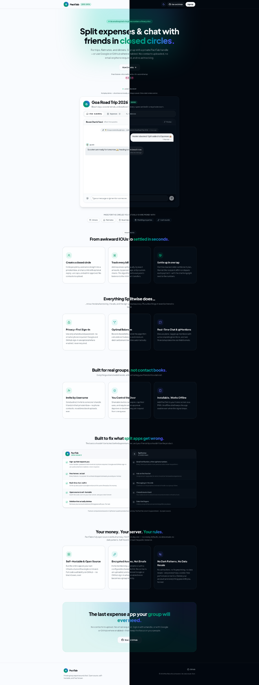

<div align="center">

# PactTab

**Split expenses & chat with friends in closed circles.**<br />
No email required. Optional Google or GitHub sign-in. Privacy-first by default.

<br />



<br />

<a href="#features">Features</a> •
<a href="#tech-stack">Tech Stack</a> •
<a href="#self-hosting">Self-Hosting</a> •
<a href="#getting-started">Getting Started</a> •
<a href="#git-hooks--contributions">Git Hooks</a> •
<a href="#architecture">Architecture</a>

</div>

---

## Overview

Existing expense-splitting applications often demand email addresses, phone numbers, contact address-book uploads, and aggressive social graph building. **PactTab** is designed specifically for flatmates, trips, dinner clubs, and close friends who want a simple, lightweight shared tab without surrendering personal privacy. Groups are private and non-discoverable by default—only users with a valid invite token can join or request entry.

---

## Features

- 🔒 **Privacy-First Authentication**: Accounts can use only a username and password, with no email or phone number required. Optional Google and GitHub sign-in is available for those who prefer it; PactTab will not request contacts or unrelated provider permissions.
- 💬 **Real-Time Group Chat & @Mentions**: In-group discussion with instant WebSocket message broadcasting, user mention autocomplete (`@username`), and contextual notification pills.
- 🔗 **Configurable Invite Links**: Create custom invite links with optional expiration dates, maximum use caps, custom slug tokens, and require-admin-approval toggles.
- 👥 **Join Request Queue & Admin Notifications**: Admins receive a real-time notification indicator for pending group join requests, with the ability to approve or decline requesters.
- 💰 **Flexible Expense Tracking**: Add expenses with equal splits or custom exact per-person amounts. Edit or remove expenses with live balance recomputations.
- ⚖️ **Optimal Balance Settlement**: Automatically computes net balances and debt-simplification settlement suggestions.
- 🤝 **Settlement Affirmation Workflow**: When a member records a settlement payment, the recipient can affirm or dispute the transaction.
- 📱 **Installable Progressive Web App (PWA)**: Includes an offline fallback shell, web app manifest, and responsive mobile-first UI for desktop and mobile devices.

---

## Tech Stack

| Layer                | Technology                                                                                                                                                                                                                                                                             |
| :------------------- | :------------------------------------------------------------------------------------------------------------------------------------------------------------------------------------------------------------------------------------------------------------------------------------- |
| **Framework**        | [Next.js 16](https://nextjs.org) (App Router, TanStack Query, API Routes)                                                                                                                                                                                                              |
| **UI & Styling**     | [React 19](https://react.dev), [Tailwind CSS v4](https://tailwindcss.com), [Base UI](https://base-ui.com), [Lucide React](https://lucide.dev), [Sonner](https://sonner.emilkowal.ski)                                                                                                  |
| **Database**         | [PostgreSQL](https://www.postgresql.org) with [Drizzle ORM](https://orm.drizzle.team)                                                                                                                                                                                                  |
| **Real-Time & Sync** | [WebSockets](https://github.com/websockets/ws) (`ws`), [Redis Pub/Sub](https://redis.io) (`ioredis`), [TanStack Query](https://tanstack.com/query) for client-side caching                                                                                                             |
| **Authentication**   | [Better Auth](https://www.better-auth.com) session-based credentials                                                                                                                                                                                                                   |
| **Testing**          | [Vitest](https://vitest.dev)                                                                                                                                                                                                                                                           |
| **Tooling & Hooks**  | [pnpm](https://pnpm.io), [oxlint](https://oxc.rs/docs/guide/usage/linter.html), [oxfmt](https://oxc.rs/docs/guide/usage/formatter.html), [Husky](https://typicode.github.io/husky), [lint-staged](https://github.com/lint-staged/lint-staged), [commitlint](https://commitlint.js.org) |

---

## Getting Started

### Prerequisites

Ensure you have the following installed on your machine:

- **Node.js**: v20.x or higher
- **pnpm**: v9.x or higher
- **PostgreSQL**: v14+ running locally or a hosted instance (e.g., Neon, Supabase)
- **Redis**: v6+ running locally or hosted (e.g., Upstash)

### 1. Clone the repository

```bash
git clone https://github.com/aayushsiwa/pacttab.git
cd pacttab
```

### 2. Install dependencies

```bash
pnpm install
```

_(This also triggers the `prepare` script to initialize Husky Git hooks)._

### 3. Configure environment variables

Copy the example environment file:

```bash
cp .env.example .env
```

Edit `.env` to supply your PostgreSQL and Redis credentials. Every variable—including optional Google/GitHub sign-in keys—is documented inline in [`.env.example`](.env.example).

### 4. Initialize database schema

Run the database initialization script to create tables and relations:

```bash
pnpm run db:init
```

### 5. Start development server

PactTab runs a unified HTTP and WebSocket server powered by `tsx server.ts`:

```bash
pnpm dev
```

Open [http://localhost:3000](http://localhost:3000) in your browser.

### Optional Google and GitHub sign-in

Local handle-and-password accounts remain the default. Social providers are opt-in per provider: provide both the client ID and secret for Google and/or GitHub. A provider with missing or blank credentials is not activated or shown. See the [Optional Social Sign-In POC](pocs/social-auth-poc.md) for the Better Auth migration, privacy, and rollout requirements.

---

## Git Hooks & Contributions

PactTab uses **Husky**, **lint-staged**, and **commitlint** to ensure high code quality:

- **`pre-commit`**: Automatically runs `oxlint --fix` and `oxfmt` exclusively on staged files via `lint-staged`.
- **`commit-msg`**: Validates commit messages following [Conventional Commits](https://www.conventionalcommits.org/) (e.g. `feat: ...`, `fix: ...`, `docs: ...`, `chore: ...`).
- **`pre-push`**: Runs lint, format check, and the full test suite before pushing.

---

## Architecture

```
├── public/                 # Static assets, PWA manifest, service worker, icons
├── scripts/                # Database initialization and maintenance scripts
├── src/
│   ├── actions/            # Server Actions (onboarding - minimal)
│   ├── app/                # App Router pages and API routes
│   │   ├── (auth)/         # Login and signup pages (CSR with fetch)
│   │   ├── api/            # REST API routes (groups, user, auth, ws)
│   │   ├── group/[id]/     # Main group dashboard (chat, expenses, balances, settings)
│   │   ├── groups/         # Groups list & join flows (client components)
│   │   └── join/[token]/   # Invite link resolver & preview page
│   ├── components/         # Reusable UI components & dialogs
│   │   ├── group/          # Group sub-views (expenses, chat, balances, members)
│   │   └── ui/             # Radix / Base UI styled primitives
│   ├── db/                 # Drizzle ORM schema definitions and database connection
│   ├── hooks/              # Custom React hooks (queries, mutations, useGroupSocket)
│   │   ├── queries/        # TanStack Query hooks (useGroups, useExpenses, etc.)
│   │   └── mutations/      # TanStack Query mutation hooks
│   ├── lib/                # Shared utilities (auth, api-auth, balances, Redis, ws-hub, CSV export) + domain services (group, expense, chat)
│   └── types/              # TypeScript types for API responses
├── tests/                  # Vitest integration test suites
├── server.ts               # Custom Node HTTP server binding Next.js + WebSocket Hub
└── vitest.config.mts       # Vitest configuration with path aliases
```

---

## Self-Hosting

PactTab is ready to self-host with zero hassle using Docker Compose:

```bash
# 1. Clone & enter repository
git clone https://github.com/aayushsiwa/pacttab.git
cd pacttab

# 2. Setup your environment
cp .env.example .env

# 3. Start full stack (Next.js, PostgreSQL, Redis, Auto-Migrations)
docker compose up -d
```

- **Health check**: `curl http://localhost:3000/api/health`
- **Low-memory / Lite mode (no Redis)**: `docker compose -f docker-compose.lite.yml up -d`
- **Reverse proxies (Caddy/Nginx) & backups**: See the complete **[Self-Hosting Guide](docs/self-hosting.md)**.

---

## Documentation & Architecture Plans

- [Self-Hosting Guide](docs/self-hosting.md): Complete instructions for Docker Compose, low-memory mode, Caddy/Nginx reverse proxies, automated migrations, backups, and bare-metal systemd.
- [Web MCP Implementation POC](pocs/web-mcp-poc.md): Architectural design, use cases, security safeguards, and implementation roadmap for Model Context Protocol (Web MCP) support over SSE and in-browser agents.
- [Optional Social Sign-In POC](pocs/social-auth-poc.md): Google and GitHub provider architecture, privacy commitments, migration strategy, and rollout criteria.
- [MVP Specification & Roadmap](MVP.md): Detailed product requirements, data entities, and shipped milestone tracking.

---

## License

MIT License.
